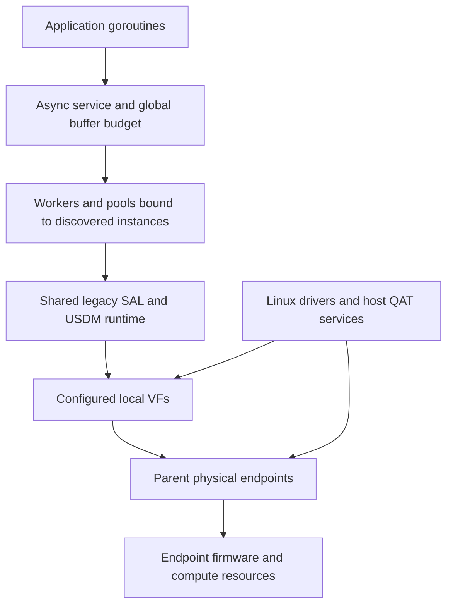

# Async QAT service design

Add a Go service above the existing `qat` package so applications can acquire a
contiguous DMA buffer, receive into its `[]byte`, hash asynchronously, and keep
the payload for downstream processing. The service owns discovery, endpoint
selection, bounded queues, native sessions, completion polling and safe cleanup.

The service discovers resources exposed to its application context. It schedules
independent blobs across those resources without requiring consumers to select
crypto instance indexes. Adding compatible hardware expands the discovered
inventory; the configured buffer budget remains global across all cards.

This is an implementation plan. The current module already provides the native
buffer, streaming, cancellation and multi-instance primitives; the proposed
`github.com/undy-io/qatgo/service` API below is not implemented yet.

Service means an in-process Go library object inside the application, not a new
system-wide device-management daemon. Use one Service per application process.
Its global buffer budget covers that Service across all selected cards; other
processes or direct low-level library users require their own resource limits.
The current `[SSL]` configuration permits one application process. Supporting
additional application processes requires deliberate host resource/process
configuration; this library does not arbitrate VFs across operating-system
processes.

## Scope and initial decisions

- Target the working C62x and Adapter 8970 legacy driver, SAL and USDM stack.
- Preserve the existing low-level `qat` API. Add the consumer API in
  `github.com/undy-io/qatgo/service`, including its own lease wrapper.
- Support complete resident blobs and incremental input into one SHA-256
  state. Add SHA-1 as an explicit optional algorithm for consumers whose
  protocol requires it.
- Use startup discovery and a fixed topology generation. Drain and recreate the
  service after hardware or driver configuration changes.
- Use one active blob per selected crypto instance initially. Different
  instances run concurrently; multiple goroutines may wait for the same result.
- Retain one application lease after hashing until its owner explicitly releases
  it. An accepted hash holds a separate internal reference to its input memory.
- Expose result availability separately from the end of memory access. A hardware
  error can become available while its DMA memory remains quarantined.
- Keep CPU fallback, live topology reconfiguration and mixed driver backends out
  of the initial implementation. Report unavailable hardware explicitly.

The [hardware hash survey](README.md#hash-support-on-the-tested-host) found SHA-1
disabled in the installed driver build. Enabling its legacy-algorithm opt-in
requires a matching kernel/userspace rebuild and module/application restart;
the library must report this requirement, rather than silently select SHA-256.
The existing low-level implementation remains SHA-256 only. Add algorithm
metadata before implementing this proposed service API. SHA-1 sessions and
validation are a separate opt-in extension, rather than a startup requirement
for SHA-256 consumers.

Start with plain SHA-256 and allow an explicit SHA-1 extension. Keep digest
length, compression-block size, full-request and incremental support explicit
per algorithm and backend.
SHA-384/512 are verified hardware extensions for later API support. SHA3-256
on this card supports only complete requests and needs a separate validated
scatter/gather path for large buffers; it is outside the initial service.
HMAC, other MACs and authenticated encryption are separate future features.

## Who manages the endpoints

| Layer | Responsibility on this host |
| --- | --- |
| Linux PCI subsystem and QAT PF drivers | Enumerate physical functions, load firmware, manage device resources and expose SR-IOV VFs. |
| `qat.service` and `/etc/init.d/qat_service` | Apply endpoint configuration, start PFs and enable their configured SR-IOV resources. |
| `qat-local-vfs.service` and `/etc/init.d/qat_service_vfs` | Bind/start local VFs after PF initialization. |
| Intel SAL and the application configuration | Expose crypto instances assigned to the configured process context, currently `[SSL]`. |
| The existing `qat.Engine` | Own one crypto instance and serialize its native submissions/polling. Distinct Engines share one process SAL/USDM runtime. |
| The proposed Go service | Select instances, allocate bounded pools, route blobs, manage jobs, observe failures and retain memory until safe. |
| Firmware within an endpoint | Arbitrate requests among the endpoint's available processing resources. |

The current adapter has three physical endpoints at `0000:3d:00.0`,
`0000:3f:00.0` and `0000:41:00.0`. Each currently exposes 16 local VFs; two
configured crypto instances per VF give 96 visible crypto instances. An API
instance is a channel to hardware, rather than a dedicated compute engine.

Physical card, physical endpoint/PF, VF and crypto instance are distinct objects.
The scheduler groups VFs by their parent PF. Physical slot/card metadata is
optional diagnostic information and an optional operator-supplied grouping;
neither PCI adjacency nor SAL `packageId` is sufficient to identify a board.

Intel describes application-directed load sharing across endpoints and hardware
arbitration within an endpoint in its
[load balancing guide](https://intel.github.io/quickassist/PG/infrastructure_load_balancing.html).
The newer qatlib `qatmgr` deployment is a different backend; this host uses the
legacy services and application configuration described above.



## Discovery and identity

Replace production use of numeric indexes such as `0`, `32` and `64` with this
startup sequence:

1. Retain a process-wide runtime for the selected backend and application name.
   Default the application name to the existing `SSL` configuration. Refuse an
   incompatible application/backend selection while another runtime user lives.
2. Enumerate crypto handles with `cpaCyGetNumInstances` and `cpaCyGetInstances`.
   Query each handle's `CpaInstanceInfo2` and symmetric capabilities. Select
   polled, hardware-offloaded candidates supporting the required algorithms and
   incremental requests. The instance-wide partial-packet flag is insufficient:
   support must be validated per algorithm/backend. Record pre-start state for
   diagnostics; this legacy driver can report
   DOWN until `cpaCyStartInstance` runs, so that state alone does not exclude a
   candidate.
3. Resolve the complete PCI domain/bus/device/function of each visible function.
   For a VF, follow `/sys/bus/pci/devices/<full-bdf>/physfn` to identify its PF.
   Record NUMA affinity and driver identity. Validate metadata against sysfs.
4. Apply optional PF allowlists and NUMA policy. Group eligible instances by
   PF and choose workers fairly across PFs before adding concurrency within a PF.
5. Start selected instances, validate their started state and construct their
   pools. Try remaining eligible candidates after an individual start failure,
   retaining the failure in inventory. Roll back this service's startup if its
   minimum endpoint requirement cannot be met. Publish selected and excluded
   entries, including capability mismatch, unavailable identity, start failure,
   or a configured concurrency limit.

Discovery means resources visible to the application's SAL context, not every
QAT device shown by `lspci`. A configured VF missing the application section,
assigned elsewhere, or unavailable to this process cannot be scheduled merely
because PCI enumeration finds it. See Intel's
[instance discovery contract](https://intel.github.io/quickassist/API_PG/baseAPI.html#instance-discovery)
and [multiple endpoint configuration](https://intel.github.io/quickassist/PG/configuration_files_multipleendpoints.html).

Add an immutable descriptor with a runtime generation, opaque instance token,
transient enumeration index, configured name, full function BDF, parent PF BDF,
NUMA node, backend/version, capabilities and selection status. Keep native
handles in C. Session and buffer resources carry the generation; stale tokens
cannot open a different instance after restart. Full BDFs are identity within
the current topology, not a promise that addresses survive slot/BIOS changes.

Two legacy API details require explicit handling:

- `CpaPhysicalInstanceId.busAddress` contains only a 16-bit packed BDF, without
  the PCI domain. The current Go `Info.PCI` consequently omits the domain.
  The installed library exports `icp_adf_cfgGetDomainAddress(packageId)`.
  Encapsulate that version-specific function in the legacy backend, combine it
  with the packed BDF, and validate the complete sysfs identity. A fallback may
  use a unique validated sysfs match; ambiguous domains must fail selection.
- The configured instance ID/name can repeat across VFs. It is not a global
  identity. Also, `icp_sal_get_num_pfs` and `icp_sal_get_pf_info` are unsupported
  stubs in this release despite their public declarations.

The shared runtime must be retainable before opening an Engine so discovery
does not require opening an arbitrary instance zero. Hold the runtime through
enumeration, selection, Engine creation, pool lifetime and final cleanup. Keep
the existing `qat.Open(Options)` behavior as a compatibility adapter.

## Configuration and bounded memory

The proposed initial configuration is:

```go
type Config struct {
    ApplicationName         string        // default "SSL"
    RequiredAlgorithms      []Algorithm   // default SHA256; fail if a requested algorithm is unavailable
    BufferCount             int           // required; global across all cards
    BufferBytes             int           // default 256 MiB
    AllocationBytes         int           // default 4 MiB; legacy accepts 2/4 MiB
    RequestBytes            int           // default 4 MiB; multiple of 64
    PollInterval            time.Duration // default 250 microseconds
    MaxWorkers              int           // zero: derive within buffer count
    MaxInstancesPerEndpoint int           // default 4
    MinEndpoints            int           // default 1; deployment readiness requirement
    MaxQueuedJobs           int           // default BufferCount, hard upper bound
    RangeQueueDepth         int           // default 2 per streaming job
    AllowedPFs              []string      // optional full PF BDF allowlist
    NUMANode                *int          // nil: all eligible nodes
}
```

Use an explicit default-config constructor so an intentional zero poll delay
continues to mean busy polling. Validate sizes, integer multiplication,
alignment and the backend's stream-length limit before allocation.

Choose workers no greater than BufferCount, MaxWorkers if set, available
instances, or the sum of per-endpoint limits. Distribute buffers globally among
selected workers. A required BufferCount avoids silently choosing a multi-GiB
allocation for the consumer. Extra configured buffers permit receiving or
downstream retention while a worker hashes another blob.

MinEndpoints lets a deployment require an expected number of selected healthy
PFs, for example six after installing two compatible three-endpoint cards.
Open fails when that requirement cannot be met; it does not silently claim
readiness using fewer endpoints. Reject configurations whose worker/buffer
limits cannot satisfy the minimum. Context cancellation is checked between
native initialization steps; it cannot forcibly interrupt an executing native
initialization call. Rollback preserves unrelated existing runtime users.

For 256 MiB buffers, 12 buffers reserve 3 GiB of payload and 24 reserve 6 GiB.
Payload backing is rounded to full physical allocation units. The alias mapping
adds virtual mappings of existing pages, not another payload copy. Report
logical payload, requested/rounded backing, native metadata and retained
allocator/cache overhead separately. BufferCount bounds payload allocations;
do not advertise an exact total-process physical-RAM cap without allocator and
driver accounting. Quarantined allocations remain charged to the same budget.
Do not allocate replacements beyond that budget when a device fails.

Bound pending jobs, streaming range descriptors, context registrations and
worker goroutines as well as payload memory. One active job per lease bounds
whole-blob jobs; RangeQueueDepth bounds repeated tiny Commit calls. A bounded
worker/queue must not be implemented by spawning unlimited blocked goroutines.

## Proposed consumer API

```go
type Algorithm uint8 // initial named values: SHA1, SHA256

type Digest struct {
    Algorithm Algorithm
    Sum       [64]byte // meaningful prefix has Size() bytes; remaining bytes zero
}
func (d Digest) Size() int
func (d Digest) Bytes() []byte // returns a copy of the meaningful prefix

func Open(ctx context.Context, cfg Config) (*Service, error)
func (s *Service) Acquire(ctx context.Context) (*Lease, error)
func (s *Service) HashAsync(opCtx context.Context, algorithm Algorithm, b *Lease, n int) (*Future, error)
func (s *Service) Begin(opCtx context.Context, algorithm Algorithm, b *Lease) (*BlobHash, error)
func (s *Service) Inventory() Inventory
func (s *Service) Status() Status
func (s *Service) Shutdown(ctx context.Context) error

func (b *Lease) Bytes() ([]byte, error)
func (b *Lease) Release() error

func (f *Future) Wait(waitCtx context.Context) (Digest, error)
func (f *Future) ResultReady() <-chan struct{}
func (f *Future) ReadsDone() <-chan struct{}
func (f *Future) WaitReads(ctx context.Context) error
func (f *Future) Cancel()

func (h *BlobHash) Commit(admissionCtx context.Context, end int) error
func (h *BlobHash) Future() *Future
func (h *BlobHash) FinishAsync(admissionCtx context.Context) (*Future, error)
func (h *BlobHash) Cancel()
```

`Acquire` selects a free lease and its owning worker. It waits with context
cancellation when no eligible buffer is free. Consumers do not select device
indexes. All bytes are exposed through one contiguous virtual slice with the
configured length and capacity.

`HashAsync` borrows the first `n` bytes, including an empty input when `n == 0`.
`opCtx` controls admission and the operation's lifetime. Failure before accepted
handoff leaves the lease unchanged. After handoff, always return the Future;
a concurrent context cancellation becomes the Future's outcome. `Wait`'s
context controls that particular wait only. Multiple waiters read one stored,
immutable digest/error after ResultReady closes. Return Digest by value so
waiters cannot mutate the stored result. Reject unknown algorithms or algorithms
not admitted by RequiredAlgorithms before taking a lease reference. Inventory
and startup errors distinguish disabled driver capabilities from missing Go
backend support. SHA-1's digest is 20 bytes and SHA-256's is 32 bytes.

Whole-blob use, with cleanup errors abbreviated:

```go
lease, err := svc.Acquire(ctx)
if err != nil { return err }
defer lease.Release() // logical release; active DMA still holds its own reference

payload, err := lease.Bytes()
if err != nil { return err }
n, err := io.ReadFull(reader, payload)
if err != nil && err != io.EOF && err != io.ErrUnexpectedEOF { return err }

future, err := svc.HashAsync(opCtx, SHA1, lease, n)
if err != nil { return err }
digest, err := future.Wait(waitCtx)
if err != nil { return err }

// Successful Wait establishes that QAT has stopped reading this input.
// The application can use payload downstream before releasing its lease.
return consumePayload(payload[:n], digest)
```

Permit one active whole-blob hash or streaming hash per lease in version one.
Reject a second operation with ErrInUse. Independent hashes use independent
leases. Result completion does not recycle a payload that the application still
owns.

## Streaming into the same contiguous blob

`Begin` accepts one streaming job, retains the lease and creates its
Future immediately. Commit uses a monotonically increasing absolute byte
offset: `Commit(ctx, end)` appends `[previousEnd:end]` to one state for the
selected algorithm.
Equal offsets are a no-op; backward/out-of-range offsets are rejected. Advance
the accepted cursor only after successful queue admission.

The producer can fill the uncommitted suffix while QAT reads committed ranges.
Committed bytes must remain unchanged until the corresponding reads end.
Version one retains the whole committed prefix until the job completes rather
than exposing region reuse through the convenience API. The existing low-level
SubmitRange API remains available for advanced range ownership.

```go
h, err := svc.Begin(opCtx, SHA1, lease)
if err != nil { return err }
defer h.Cancel() // no effect after a completed result

end := 0
for end < len(payload) {
    next := min(end + 4*qat.MiB, len(payload))
    n, readErr := io.ReadFull(reader, payload[end:next])
    end += n
    if n > 0 {
        if err := h.Commit(ctx, end); err != nil { return err }
    }
    if readErr == io.EOF || readErr == io.ErrUnexpectedEOF { break }
    if readErr != nil { return readErr }
}
future, err := h.FinishAsync(ctx)
if err != nil { return err }
digest, err := future.Wait(waitCtx)
```

FinishAsync seals input and returns the same Future without waiting for the
digest. Repeated sealing is idempotent. Its admission context covers acquiring
the producer gate; expiration before sealing permits retry. Cancel also works
before sealing. Releasing the application lease prevents further Bytes/Commit
calls but does not itself finish an unfinished stream; FinishAsync or Cancel is
required. Shutdown cancels unfinished streams so it can drain them.

Accept arbitrary final lengths and empty blobs. Retain the existing 64-byte
tail handling and backend stream-size limit. A short final receive remains part
of the same digest; Commit does not create independent chunk digests.

## Lease ownership and future completion

Each service lease has an application reference, internal operation references,
a released flag, an active-job identity and an allocation generation. The
service retains the underlying low-level Buffer until its own ownership checks
allow return. This preserves the low-level Release behavior while offering
deferred physical recycling through the service wrapper.

Release is an idempotent logical release: the caller gives up all access at
once, including raw slice aliases. Recycling occurs only when the application
reference and all operation references have ended and DMA safety is confirmed.
An accepted operation continues or drains after early application release.
A fresh Acquire creates a fresh lease object so stale handles never revive.
No GC finalizer frees or returns live DMA memory.

HashAsync makes its input prefix immutable until ReadsDone. Bytes rejects new
writable access during a whole-blob hash; a streaming producer uses the slice
obtained before Begin to fill only the uncommitted suffix. Go cannot
invalidate an already returned `[]byte`, so consumers must obey these mutation
and lifetime rules. Ordinary I/O must finish using its slice before application
release. Any future library-managed Fill/ReadFrom helper must hold its own write
reference while a reader is blocked, rather than relying on GC reachability.

ResultReady means a stable digest/error is available. ReadsDone means this
operation can never again access the input. WaitReads waits for that second
condition and returns nil on confirmation, regardless of the hash outcome.
A successful Wait implies ReadsDone is already closed. A hardware timeout may
publish an error while ReadsDone stays open and its input remains quarantined.
Request counters are diagnostics and never establish reuse permission.

| Job state or event | ResultReady | ReadsDone | Memory consequence |
| --- | --- | --- | --- |
| Queued | Open | Open | Internal reference held. |
| Dispatched and entering/waiting in native code | Open | Open | Native pointers may be in use even before CPA acceptance. |
| Hardware request accepted | Open | Open | Input remains owned until completion/drain. |
| Queued cancellation atomically acknowledged before dispatch | Canceled | Closed | Internal reference ends. |
| Cancellation while a native call is active | Open until acknowledged/drained | Open until acknowledged/drained | Retain memory; native failure can take precedence. |
| Hash completed and native cleanup is safe | Digest or operation error | Closed before publishing result | Application can retain its payload. |
| Timeout or uncertain polling failure | Hardware error | Open | Keep stream/allocation quarantined. |
| Caller wait deadline | No state change | No state change | Only that waiter returns. |
| Late completion plus confirmed cleanup | Existing error remains stable | Closed | Drop the quarantined internal reference. |

Queued cancellation may release its reference only if the scheduler proves the
worker never claimed the job. `Submitted == 0` is insufficient: a C call may be
waiting for an engine mutex while holding buffer pointers. Cancellation of a
dispatched job requires an acknowledgment from the worker/native call.

Publish ReadsDone and drop safe internal references before publishing a
successful result. If cancellation races a failing accepted request, preserve
the native failure instead of publishing an early context.Canceled result.

## Worker scheduling and concurrency

Allocate and schedule at the same ownership boundary. Acquire ranks free buffers
using the owning worker's admitted/active jobs, receiving leases and downstream
retention. Prefer available capacity on less loaded eligible endpoints and
respect NUMA filters. Once acquired, a buffer remains bound to its owning
Engine; HashAsync cannot silently move it to another Engine or copy the payload.

Start with one worker and one active native hash per selected instance. A stream
keeps that instance/session until finalized or canceled. Waiting for additional
input may leave its worker idle; account for receiving streams explicitly.
Request-level multiplexing of several streams on one instance is a later
optimization, requiring a distinct fairness and polling design.

Allocate payload backing on the owning endpoint's NUMA node. Respect the
process/container CPU mask and record the actual placement policy; choosing a
NUMA-local allocation does not pin a Go goroutine to that node. For deployments
with endpoints on several sockets, support explicit binding of the actual
native submission/polling execution to allowed CPUs near its endpoint. Pinning
only an outer service goroutine would not pin the current core Stream worker
that executes C calls. Any thread-affinity change must be restored before a
thread returns to unrelated Go work. Validate the binding policy and input-I/O
locality when benchmarking the second card.

Admit jobs through bounded permits and short ownership transitions. Never hold
a lease or global scheduler mutex while waiting for queue capacity, native work,
or completion. An admission cancellation rolls back a reserved reference only
when handoff did not occur. Protect queue removal versus worker claim with one
job state transition so a canceled entry cannot be both released and dispatched.

Keep native polling/submission per instance independent. Reuse the existing
C-owned callback/session/buffer data and cgo pointer discipline. Job context
cancellation requests core Stream.Cancel; worker cleanup waits independently of
consumer wait contexts. The service owns all completion and recovery work.

Do not rebalance active or downstream-owned allocations. Initial pool assignment
is fixed for a service generation. Any future rebalance may operate only on free
allocations and must remain inside the memory budget.

## Errors health and safe recovery

Separate argument/admission errors, operation cancellation, completed hardware
errors and failures with uncertain DMA. Include runtime generation, instance and
full PF/function identity in hardware diagnostics. Preserve the underlying error
and whether memory remains quarantined; consumers do not infer safety from error
strings or errors.Is(err, context.Canceled).

Add an explicit low-level cleanup status, independent of the hash result. Core
Stream.Close currently returns context.Canceled after successful cleanup and can
join a native cleanup failure with that error. The service needs a reliable
fully closed condition to distinguish those cases before ReadsDone. It must
acknowledge the entire core cleanup: native session release, quarantine region
completion, core reference/ownership bookkeeping and final closed state. A
cleared native pointer by itself is not sufficient to recycle a core Buffer.

A timeout/poll failure stops new admissions to that instance. An observed PF
restart or fatal device event expands the affected scope to sibling instances
and VFs under that PF. Do not infer that one failed request means the entire
physical card failed. Failed/completed operations do not automatically poison
healthy endpoints; healthy workers continue within the remaining buffer budget.

The current core worker stops its normal polling after a timeout. Add a bounded
recovery loop that retains affected streams and retries the safe Close/poll path
so a late callback can permit cleanup. Bound concurrent recovery workers and work
per attempt, use backoff, and keep recovery alive after a Shutdown wait deadline;
do not abandon polling solely because a timer or retry count expired. Keep the
original error result stable.
If safe completion cannot be confirmed, retain quarantine and report the bytes,
age and affected resources. A timer, waiter cancellation, fd close or operator
reset is not by itself a backend proof that DMA has ended.

Do not automatically reset PFs or restart host QAT services. Such actions can
affect other instances/processes. Recovery that needs a device reset is an
explicit coordinated maintenance operation. A poisoned low-level Engine is not
silently reused after freeing one stream; initial recovery returns memory when
safe and leaves the instance unavailable until a drained service restart.

## Shutdown and topology changes

Shutdown transitions Running to Draining and refuses new acquisitions and jobs.
Cancel queued jobs and unsealed streaming jobs; let already running sealed
jobs finish, including resident hashes and streams sealed by FinishAsync. Keep
pollers and recovery active while waiting for native
work, all application leases and quarantines to end. Explicit Future.Cancel
remains available for callers who want to stop a running sealed job.

The Shutdown context bounds only waiting. Expiration returns a diagnostic with
outstanding job, lease and quarantine counts and leaves the service Draining.
A later Shutdown can wait again. Application-held payloads are never reclaimed
implicitly. Close pools/Engines and release the shared runtime only after all
references are gone. Service closure cannot destroy global USDM memory used by
an independent remaining runtime user.

Use startup-only topology discovery for the first version. Installing hardware,
changing process sections, changing VF assignment, or restarting driver services
requires coordinated drain and service recreation. Unexpected device removal is
a failure event with retained uncertain memory, not a safe hot-reload mechanism.

## Installing a second card

A second compatible three-endpoint C62x/8970 adapter would normally give six PFs.
With the same 16 VFs per PF and two crypto instances per VF, the configured
totals would be 96 VFs and 192 crypto instances. These totals describe that
configuration; discovery must obtain actual counts and capabilities.

The existing host scripts enumerate PFs and VFs dynamically. However, `/etc`
currently has only `c6xx_dev0..2.conf` and `c6xxvf_dev0..47.conf`. Additional
PF/VF configuration is required. Device numbering may change after insertion;
do not assume existing enumeration indexes or config-to-device mappings remain
unchanged. The intended operational sequence is:

1. Drain the application and plan host changes in a maintenance window. Preserve
   current configuration and inventory before installing the hardware.
2. Verify the second card is supported by the selected legacy stack; inspect
   firmware/driver binding, complete PCI identities, NUMA placement and PCIe
   topology/link widths for every new endpoint.
3. Provision the additional PF and local-VF configuration, preserving customized
   service settings and the application's matching section/process capacity.
   With two identical cards, expect six PF and 96 VF configs in total, validated
   against actual enumeration.
4. Initialize the resources through the host QAT services and confirm their
   states. Ensure these VFs are available locally to the service's context.
5. Recreate the Go service. Its new inventory should include eligible instances
   across both cards, selected within the existing global memory/worker limits.
6. Verify digests, ownership, cancellation and cross-endpoint operation before
   measuring throughput and deliberately changing concurrency or memory limits.

Do not use the current hard-coded benchmark presets as discovery. Replace them
with descriptor-based selection and preserve any host-specific regression cases
as explicitly named legacy presets.

Do not blindly run `make qat-conf-install` to add the card: the current target
moves all existing QAT configs aside and regenerates them. Its template loops
support additional same-family endpoints, but configuration extension should
preserve the working custom setup. The installed legacy service scripts are not
hard-coded to the current three PCI buses.

Adding a card does not multiply BufferCount. A configuration with 12 buffers
still has 3 GiB of payload across both cards. Additional hardware may reduce
contention or permit wider distribution; greater throughput can require more
simultaneous blobs and an explicit budget increase. Shared PCIe upstream links,
NUMA paths, memory bandwidth and CPU submission capacity can limit scaling.

A newer QAT generation needs a backend compatibility assessment. Intel assigns
C62x/8960/8970 to its
[CE driver family](https://www.intel.com/content/www/us/en/support/articles/000094285/technologies/intel-quickassist-technology-intel-qat.html).
The legacy alias allocator and SAL/USDM runtime are not a portable qatlib/VFIO
allocator. Keep the public service API independent of backend memory/discovery
details; a newer or mixed-generation implementation may need a separate build
or process backend rather than loading conflicting runtime libraries together.

## Observability and validation

Expose inventory by full PF/VF identity and NUMA node, selected instances and
selection reasons. Status includes free buffers, receiving/application leases,
queued/dispatched/accepted jobs, completed payloads still owned downstream,
quarantined bytes, oldest quarantine age and shutdown state. Publish admissions,
cancellations, native retries, completions, errors, queue delay, blob latency,
throughput and process CPU measurements. Avoid payload data in diagnostics.

The existing measured baselines establish the starting point, not a service
performance promise:

| Existing experiment | Result |
| --- | --- |
| One instance, resident 256 MiB blob | About 580 MiB/s. |
| Three endpoints, four instances each | About 6,805 MiB/s with 12 buffers and 3 GiB payload. |
| Three endpoints, eight instances each | About 12,796 MiB/s with 24 buffers and 6 GiB payload; 2.66 times the matched CPU baseline. |
| Overlapped synthetic receive/hash versus waiting per range | 445.338 versus 497.794 ms; 1.118 times throughput. |
| Fresh allocation/free versus reuse | About 71.354 ms directly in allocation/free per 256 MiB blob. |

Keep benchmark source/settings, raw samples and Go digest verification. See
[parallel results](parallel-256mib.json), [overlapped input](receive-overlap.json),
[serial input control](receive-serial.json) and
[allocation results](allocation-256mib.json).

Use a deterministic backend for scheduler and failure tests, supplemented by
real-hardware integration tests:

- Reordered indexes, repeated names, nonzero/ambiguous PCI domains, missing PF
  mapping, several PFs on one board, a second card, NUMA differences, capability
  exclusions, and fewer available instances than requested workers.
- Global buffer distribution and overflow/rounding checks; no allocation growth
  after adding a card or quarantining memory; bounded tiny Commit descriptors.
- Multiple independent blobs, multi-waiter futures, retained downstream payloads,
  early/idempotent Release, stale aliases/leases and repeated lease reuse.
- Empty inputs, SHA padding/allocation boundaries, arbitrary commits, short final
  input, producer backpressure, context races and failed admission rollback.
- Cancellation before claim, during native admission, after actual hardware
  acceptance and during finalization; a native failure must win its cancellation
  race. Wait deadlines must not release memory.
- Timeout followed by a late completion: result publishes once, ReadsDone stays
  open until safe cleanup, recovery continues polling and memory stays charged.
- Shutdown with active input, sealed hashes, downstream leases and quarantine;
  deadline/retry must preserve resources. Close one Engine while others work.
- Hardware/cgo/race checks and process CPU/throughput comparison at matched
  worker counts, plus actual consumer I/O measurements using reused buffers.

Hardware tests must observe real accepted work when claiming in-flight behavior.
Delayed polling can create an observation window; pending callbacks alone do
not establish simultaneous silicon execution. Keep destructive failure/reset
injection out of routine tests. Validate the second physical card when one is
installed; simulated inventory cannot establish its throughput or compatibility.

## Implementation sequence

Expected additions are root-level runtime/discovery and cleanup-status support;
`service/{config,service,lease,future,worker,stream,recovery,status}.go`; an
inventory command such as `cmd/qatinfo`; and a complete consumer lifecycle
example. A deterministic backend adapter enables scheduler/failure tests without
device resets. Keep host configuration/provisioning scripts outside the library.

1. **Algorithms, runtime and inventory.** Add algorithm metadata while preserving
   the existing SHA-256 API. Keep SHA-1 optional: add native sessions and tests
   against Go's crypto/sha1 only when a consumer needs that algorithm. After a
   deliberate host opt-in rebuild, verify SHA-1 whole/partial requests and
   benchmark representative protocol piece sizes. Add retainable discovery,
   backend capability descriptors, full domain/PF identity, generation checks
   and an inventory CLI.
   Remove hard-coded production topology. Validate against the current three PFs
   and a simulated reordered/multi-card inventory.
2. **Lease and cleanup contract.** Add the service wrapper's owner/borrow states,
   explicit native-cleanup status, typed errors and deferred recycling. Prove
   early release and timeout quarantine before adding convenience APIs.
3. **Bounded whole-blob service.** Implement Acquire, HashAsync, Future signals,
   per-instance workers, atomic admission/claim/cancel transitions and Status.
   Run a consumer example that reads ordinary Go I/O into pooled DMA slices and
   retains the payload after hashing.
4. **Streaming facade.** Implement monotonic Commit, producer backpressure,
   early Future access, asynchronous sealing, short input and cancellation.
   Demonstrate one 256 MiB slice with the receiver and QAT using disjoint ranges.
5. **Health and lifecycle.** Add bounded late-completion recovery, failure-domain
   admission control and deadline-safe Shutdown. Validate runtime sharing and
   service restart after a changed topology snapshot.
6. **Integration and performance.** Replace host-specific benchmark selection
   with inventory selection, compare wrapper overhead against the existing
   backend and CPU baselines, and exercise the consumer's bounded buffer lifecycle.
   Repeat hardware validation on a second compatible card when available.

The first integration is complete when consumers can allocate, receive, submit,
await/cancel, retain and release blobs without managing instance indexes or
pollers, and tests prove that neither cancellation nor errors can recycle memory
while an application owner or native operation still holds it.
